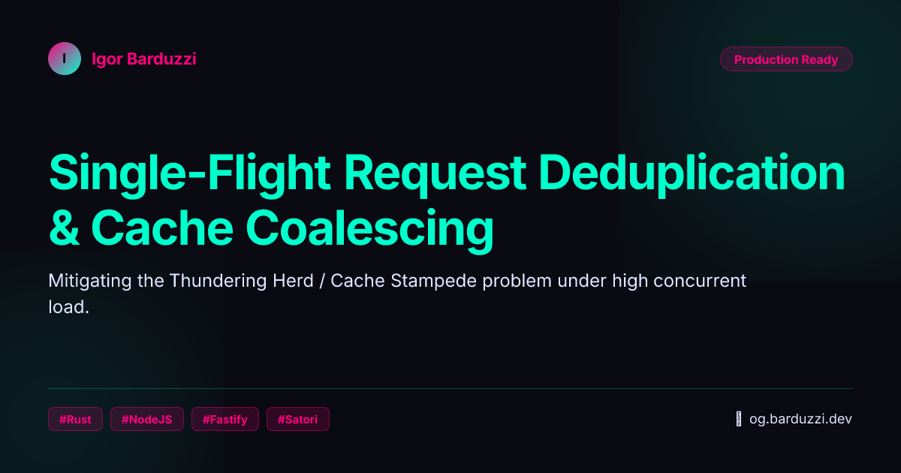
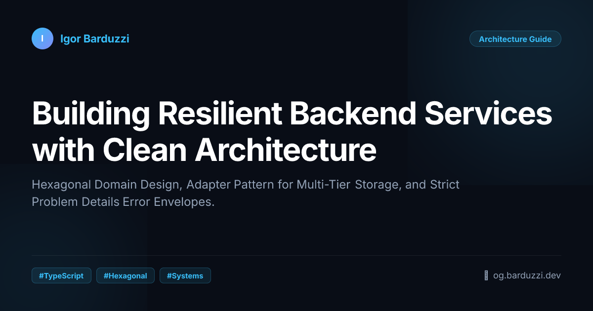
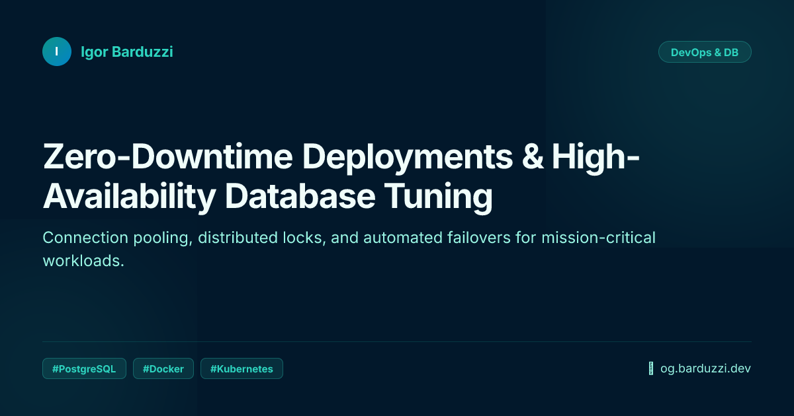
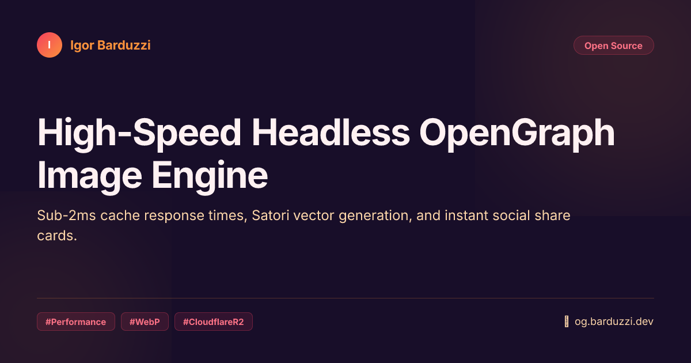
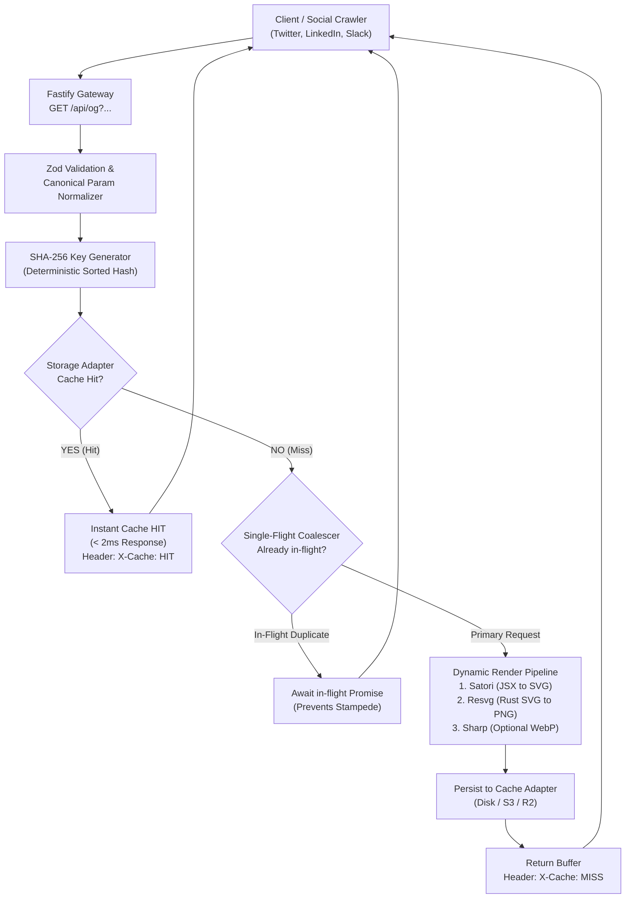

<div align="center">

# ⚡ Headless OpenGraph Image Engine

### High-performance, headless social card generator with multi-tier caching, deterministic hashing, and single-flight stampede protection.

[](https://www.typescriptlang.org/)
[](https://nodejs.org/)
[](https://fastify.dev/)
[](https://github.com/RazrFalcon/resvg)
[](https://vitest.dev/)
[](LICENSE)

[Live Demo](#-interactive-live-sandbox) • [Architecture](#-architecture--the-engine-under-the-hood) • [Benchmarks](#-benchmark-results) • [API Reference](#-api-reference) • [Quickstart](#-quickstart)

</div>

---

## 💡 Why This Project?

Generating dynamic OpenGraph preview images on the fly is essential for social media engagement on X (Twitter), LinkedIn, WhatsApp, and Slack. However, traditional approaches suffer from major drawbacks:

1. **Heavy Chromium / Puppeteer Instances**: Spawn headless browsers that consume **~1GB RAM** and take **1.5s–3s** per request.
2. **Vendor Lock-in (`@vercel/og`)**: Tied exclusively to Vercel's edge network and custom runtime limits.
3. **Cache Stampedes / Thundering Herds**: When a post is shared across multiple platforms simultaneously, dozens of crawler bots hit the uncached URL concurrently, exhausting CPU resources.

**This engine solves all three problems:**
- **Lightweight & Blazingly Fast**: Powered by **Satori** (HTML/JSX to SVG) and **@resvg/resvg-js** (Rust-based SVG to PNG rasterizer), requiring **0 browser dependencies**.
- **Deterministic Multi-Tier Caching**: Canonical parameter sorting with SHA-256 hashing.
- **Single-Flight Request Coalescing**: Deduplicates concurrent requests in flight so the rendering pipeline executes **only once**, regardless of bot concurrency.
- **Sub-2ms Hot Latency**: Delivers pre-cached cards in **~1ms** with `Cache-Control: public, max-age=31536000, immutable`.

---

## 🖼️ Gallery of Rendered Social Cards

Cards rendered dynamically at **1200x630** (standard 1.91:1 OpenGraph ratio) across available design presets:

| Cyberpunk Theme (`?theme=cyberpunk`) | Dark Midnight Theme (`?theme=dark`) |
| :---: | :---: |
|  |  |

| Ocean Breeze Theme (`?theme=ocean`) | Sunset Glow Theme (`?theme=sunset`) |
| :---: | :---: |
|  |  |

---

## ⚡ Benchmark Results

Benchmarked with the automated suite (`npm run bench`):

```bash
═══════════════════════════════════════════════════════════════════
       ⚡ HEADLESS OPENGRAPH ENGINE - BENCHMARK SUITE             
═══════════════════════════════════════════════════════════════════

▶ [1/2] Testing Cold Start (CACHE MISS - Dynamic Rendering)...
   ✓ Cold Cache Miss latency: 262.56 ms
   ✓ Payload size: 77.7 KB

▶ [2/2] Testing Hot Path (CACHE HIT - 50 sequential requests)...

┌───────────────────────────────────────────────┐
│             BENCHMARK RESULTS SUMMARY         │
├────────────────────────────────┬──────────────┤
│ Cache MISS (Dynamic Render)    │    262.56 ms │
├────────────────────────────────┼──────────────┤
│ Cache HIT Min Latency          │      0.95 ms │
│ Cache HIT Avg Latency          │      1.07 ms │
│ Cache HIT p50 (Median)         │      1.04 ms │
│ Cache HIT p95                  │      1.37 ms │
│ Cache HIT p99                  │      1.45 ms │
│ Cache HIT Max Latency          │      1.45 ms │
└────────────────────────────────┴──────────────┘

🚀 CACHE SPEEDUP FACTOR: ~245.4x faster than cold render!
```

---

## 🏛️ Architecture & The Engine Under the Hood



### Key Engineering Patterns

#### 1. Single-Flight Request Coalescing
When multiple social scrapers request the same un-cached card concurrently, `SingleFlight` coordinates execution via a synchronized promise map. Subsequent requests latch onto the in-flight generation task rather than spawning redundant renders. CPU usage remains stable even under traffic spikes.

#### 2. Deterministic Canonical Hashing
URL query string parameters can arrive in any arbitrary order (`?title=A&author=B` vs `?author=B&title=A`). The engine normalizes and sorts all parameters alphabetically before generating the SHA-256 cache key, ensuring zero cache fragmentation.

#### 3. Storage Adapter Pattern (Hexagonal Port)
Storage implementations conform to the `StorageAdapter` interface:
- **`DiskStorageAdapter`**: Atomic local filesystem read/writes with sanitized paths.
- **`MemoryStorageAdapter`**: In-memory store for unit tests and ephemeral environments.
- **`S3StorageAdapter`**: Drop-in adapter for AWS S3 and Cloudflare R2 object stores.

#### 4. Singleton Font Warmup
Instead of executing disk I/O on every request, font buffers (*Inter Regular* & *Inter Bold*) are preloaded into memory during server boot, trimming 30–50ms off cold renders.

#### 5. Graceful Degradation & RFC 7807 Envelopes
If a template encounters unexpected syntax or data anomalies, the engine serves a pre-compiled SVG fallback card (`X-Cache: FALLBACK`), preventing crawlers from ever seeing an HTTP 500 error page. Validation errors return standard RFC 7807 problem details.

---

## 🎮 Interactive Live Sandbox

The engine ships with a built-in developer playground accessible at `/demo` (or `/`):

- **Real-Time Visual Preview**: See card updates as you type with debounced live updates.
- **Theme & Format Switcher**: Toggle instantly between themes (`dark`, `cyberpunk`, `ocean`, `sunset`, `light`, `minimal`) and formats (`PNG`, `WebP`).
- **Telemetry HUD**: Displays live cache status (`HIT` vs `MISS`), response latency in ms, payload size in KB, and computed cache key.
- **One-Click URL Copy**: Copy production-ready social image tags for your meta headers.

---

## 📖 API Reference

### `GET /api/og`

Generates or retrieves a cached OpenGraph card.

#### Query Parameters

| Parameter | Type | Default | Description |
| :--- | :--- | :--- | :--- |
| `title` | `string` | **Required** | The main card headline (max 140 characters). |
| `description` | `string` | `optional` | Subtitle or summary text (max 220 characters). |
| `author` | `string` | `optional` | Author name or handle (max 60 characters). |
| `badge` | `string` | `optional` | Top-right pill label (e.g. `v1.0.0`, `Production Ready`). |
| `tags` | `string` | `optional` | Comma-separated tags (e.g. `Rust,TypeScript,Fastify`). |
| `theme` | `enum` | `'dark'` | `dark`, `light`, `cyberpunk`, `ocean`, `sunset`, `minimal`. |
| `format` | `enum` | `'png'` | Output format: `png` or `webp`. |
| `site` | `string` | `optional` | Footer site branding URL. |

#### Response Headers

| Header | Example | Description |
| :--- | :--- | :--- |
| `Content-Type` | `image/png` | MIME type of the binary payload. |
| `Cache-Control` | `public, max-age=31536000, immutable` | Tells CDNs and browsers to cache forever. |
| `X-Cache` | `HIT` \| `MISS` \| `FALLBACK` | Cache resolution status. |
| `X-Cache-Key` | `a3b78c...4f.png` | Deterministic SHA-256 hash key. |
| `Server-Timing` | `hit;dur=1.04;desc="Cache Hit"` | Standard W3C Server-Timing metric. |

---

## 🚀 Quickstart

### Prerequisites
- Node.js 20+ (recommended: Node.js 22 or 25)
- npm or pnpm

### 1. Installation
```bash
git clone https://github.com/your-username/headless-og-generator.git
cd headless-og-generator
npm install
```

### 2. Development Mode
```bash
npm run dev
```
Open [http://localhost:3000/demo](http://localhost:3000/demo) in your browser.

### 3. Run Automated Tests
```bash
npm test
```

### 4. Run Benchmark Suite
```bash
npm run bench
```

### 5. Production Build & Start
```bash
npm run build
npm start
```

---

## 🐳 Docker Deployment

A production-ready, multi-stage, non-root `Dockerfile` is included:

```bash
# Build and run with Docker Compose
docker compose up -d

# Check healthcheck status
docker compose ps
```

---

## 📄 License

This project is licensed under the [MIT License](LICENSE).
